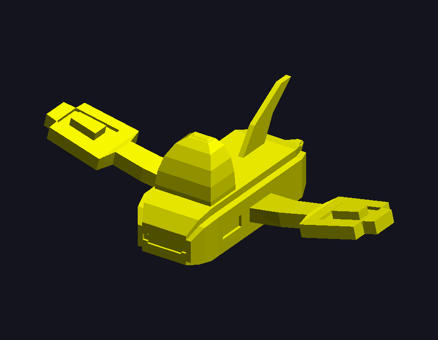

# Lab4-cargamodelos

Renderizador por software en Rust: carga `hoverpiilder.obj`, recorre las caras, toma los índices de los vértices y rasteriza cada triángulo (baricéntricas + z-buffer, sombreado plano).



## Uso

```
cargo run --release                                   # ventana (flechas rotan, Esc sale)
cargo run --release -- hoverpiilder.obj --save docs/render.png   # guarda PNG
```
